# Sistem Penjualan Toko Kecantikan
## Deskripsi Program
Program ini merupakan aplikasi berbasis terminal untuk membantu admin/kasir mengelola toko kecantikan Aye's Beauty Store. Fitur program mencakup pengelolaan produk skincare dan makeup, pembelian, pembayaran, riwayat transaksi, daftar produk, serta informasi dan pengaturan nama toko.

Program dibuat menggunakan Python dengan konsep Object-Oriented Programming (OOP), meliputi abstraksi, inheritance, polimorfisme, duck typing, operator overloading, enkapsulasi, dan relasi antarkelas.

## Class Diagram
<!-- Bagian diagram dan penjelasan relasi dipertahankan untuk dilengkapi/diperbaiki sendiri. -->

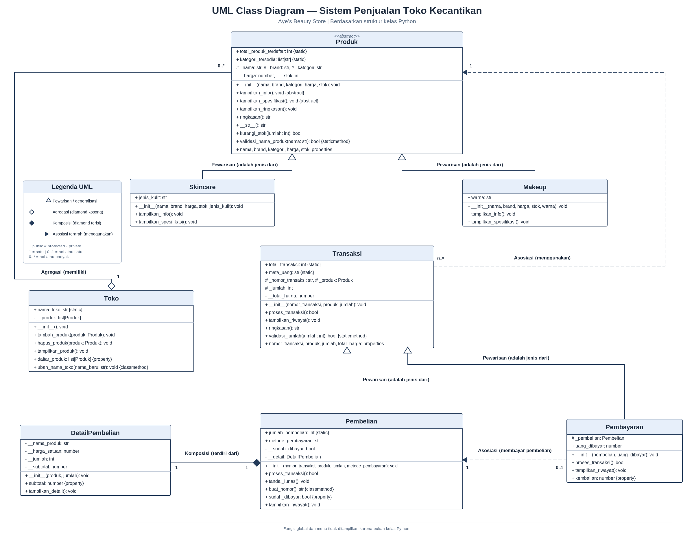

### Penjelasan Relasi Kelas
1. ****Asosiasi — `Transaksi` dengan `Produk`****  

   Kelas `Transaksi` menyimpan referensi objek produk melalui atribut `_produk` untuk memproses transaksi dan mengurangi stok. Produk dapat dibuat sebagai objek tersendiri, sehingga relasinya berupa asosiasi. Kelas `Pembayaran` juga menyimpan referensi ke objek `Pembelian` melalui atribut `_pembelian` untuk memeriksa dan memperbarui status pembayaran.

2. ****Agregasi — `Toko` dengan `Produk`****  

   Kelas `Toko` menyimpan kumpulan objek produk pada atribut `__produk` melalui method `tambah_produk()`. Objek produk dibuat terlebih dahulu di menu tambah produk, lalu dimasukkan ke toko; objek produk bukan dibuat oleh konstruktor `Toko`.

3. ****Komposisi — `Pembelian` dengan `DetailPembelian`****  

   Kelas `Pembelian` membuat objek `DetailPembelian` di dalam konstruktor dan menyimpannya pada atribut privat `__detail`. Detail pembelian dibuat khusus untuk satu objek pembelian dan menjadi bagian dari data pembelian tersebut.

## Penerapan Abstraksi
Kelas `Produk` merupakan abstract class yang mewarisi `ABC`. Kelas ini memiliki dua abstract method, yaitu `tampilkan_info()` dan `tampilkan_spesifikasi()`, sehingga `Produk` tidak dapat diinstansiasi secara langsung.

Kelas `Skincare` dan `Makeup` merupakan subclass dari `Produk` dan mengimplementasikan kedua abstract method tersebut. `Skincare` memiliki atribut unik `jenis_kulit`, sedangkan `Makeup` memiliki atribut unik `warna`. Keduanya memanggil `super().__init__(...)` untuk menginisialisasi atribut umum yang diwarisi dari `Produk`.

Method konkret `tampilkan_ringkasan()` berada di kelas `Produk`. Method ini menampilkan informasi umum produk dan memanggil `tampilkan_spesifikasi()` agar detail khusus ditampilkan sesuai implementasi subclass.

Bukti abstract class tidak dapat diinstansiasi ditampilkan pada menu ****Informasi Toko****. Program mencoba membuat objek `Produk` di dalam `try-except TypeError`; karena `Produk` masih memiliki abstract method, Python menolak instansiasi dan program menampilkan pesan keberhasilan beserta penyebab `TypeError`.

## Penerapan Polimorfisme
### 1. Polimorfisme melalui Pewarisan
Method `tampilkan_info()` diimplementasikan oleh kelas `Skincare` dan `Makeup`. Method tersebut dipanggil melalui satu loop di `Toko.tampilkan_produk()` untuk objek produk yang berbeda. Setiap subclass menjalankan implementasinya sendiri, sedangkan `tampilkan_spesifikasi()` menampilkan informasi khusus berupa `jenis_kulit` atau `warna`.

Polimorfisme pewarisan juga diterapkan pada method `proses_transaksi()`. Kelas `Pembelian` dan `Pembayaran` meng-override method tersebut dengan perilaku berbeda: `Pembelian` memproses pembelian dan membuat detail pembelian, sedangkan `Pembayaran` memeriksa pembayaran, menghitung kembalian, dan menandai pembelian sebagai lunas.

### 2. Duck Typing
Kelas `Produk` dan `Transaksi` tidak memiliki hubungan pewarisan langsung, tetapi keduanya menyediakan method `ringkasan()`. Fungsi `tampilkan_objek(objek)` cukup memanggil `objek.ringkasan()` tanpa memeriksa tipe objek. Fungsi yang sama digunakan untuk menampilkan ringkasan produk, pembelian, dan pembayaran yang mewarisi `Transaksi`.

### 3. Operator Overloading
Kelas `Produk` menerapkan magic method `__str__()`, yang mengembalikan teks dari method `ringkasan()`. Dengan demikian, objek produk dapat direpresentasikan sebagai teks ketika dicetak, misalnya dengan `print(produk)`.

### 4. Inheritance dan Enkapsulasi
`Skincare` dan `Makeup` mewarisi kelas `Produk`. Kelas `Pembelian` dan `Pembayaran` mewarisi kelas `Transaksi`. Subclass menggunakan `super().__init__(...)` untuk memanggil konstruktor induknya. Contoh atribut protected adalah `_nama`, `_brand`, `_kategori`, `_nomor_transaksi`, dan `_produk`; contoh atribut private adalah `__harga`, `__stok`, `__detail`, dan `__sudah_dibayar`.

## Screenshot Output Program

### A. Menu Utama
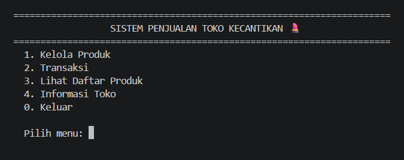

### B. Menu 1 — Kelola Produk
#### B1. Menu Kelola Produk
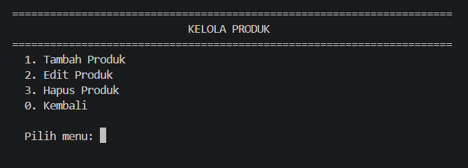

#### B2. Tambah Produk — Skincare berhasil

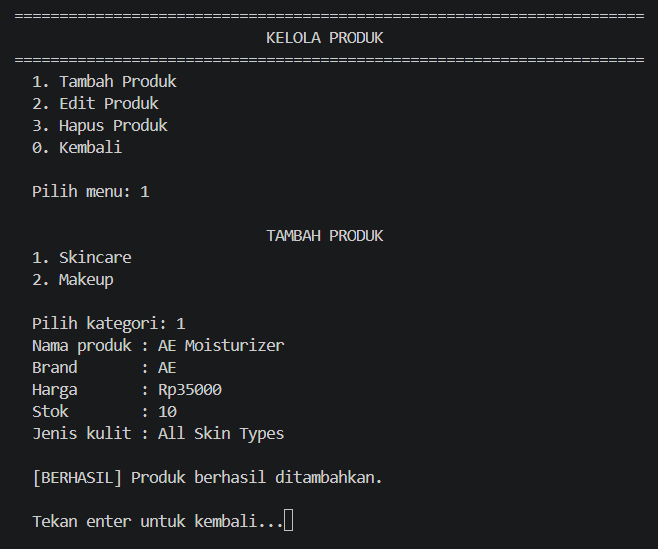

#### B3. Edit Harga Berhasil

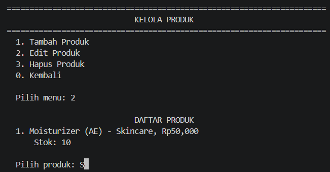

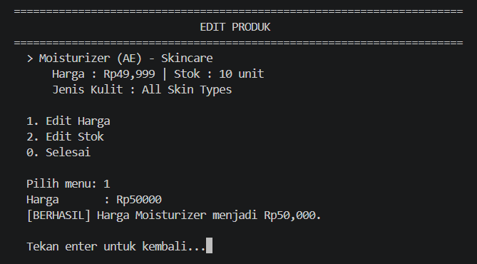

#### B4. Hapus Produk Berhasil

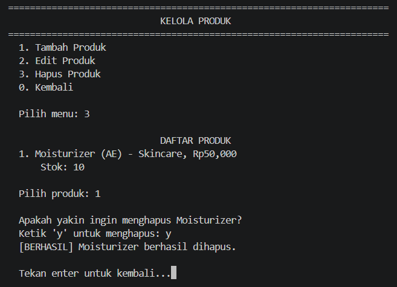

### C. Menu 2 — Transaksi
#### C1. Menu Transaksi
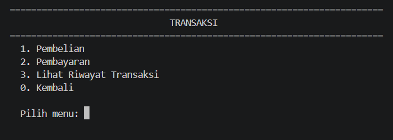

#### C2. Pembelian Berhasil

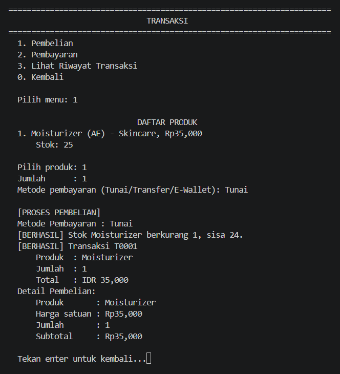

#### C3. Pembayaran Berhasil

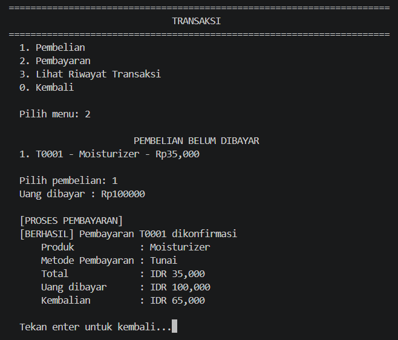

#### C4. Riwayat Transaksi

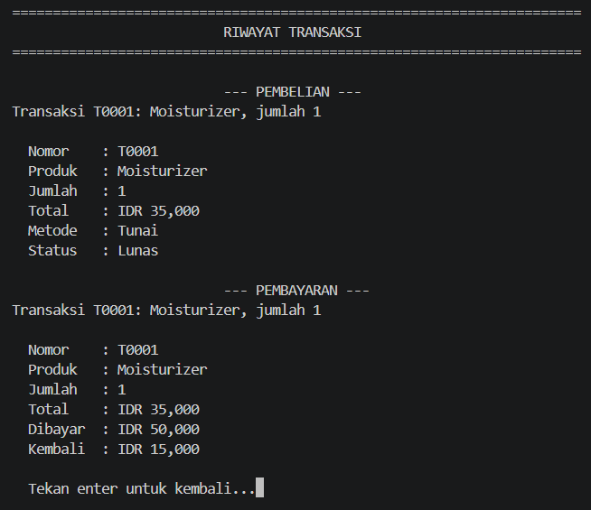

### D. Menu 3 — Lihat Daftar Produk

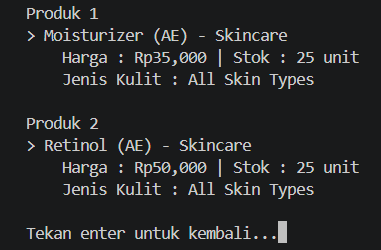

### E. Menu 4 — Informasi Toko
#### E1. Informasi Toko dan Bukti Abstract Class

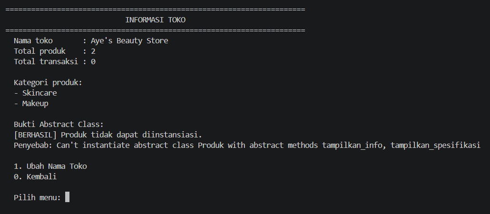

#### E2. Ubah Nama Toko Berhasil
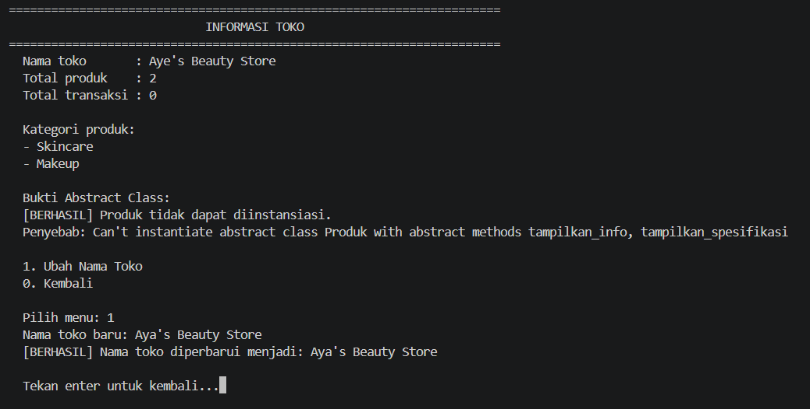

### F. Keluar dari Program
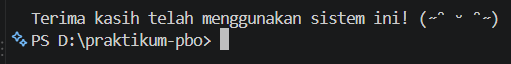

### G. Output Yang Menerapkan LSP (SOLID)

## Penerapan Prinsip SOLID — Liskov Substitution Principle (LSP)
Program ini menerapkan ****Liskov Substitution Principle (LSP)**** melalui kelas induk `Produk` dan dua subclass-nya, yaitu `Skincare` dan `Makeup`. Kedua subclass mengimplementasikan method `tampilkan_info()` dan `tampilkan_spesifikasi()` sesuai kontrak yang ditetapkan oleh kelas `Produk`.

Penerapannya terlihat pada method `tampilkan_produk()` di kelas `Toko`. Method tersebut melakukan perulangan terhadap daftar produk dan memanggil `produk.tampilkan_info()` tanpa perlu memeriksa apakah objeknya bertipe `Skincare` atau `Makeup`. Dengan demikian, objek kedua subclass dapat digunakan secara bergantian dalam daftar produk, sementara masing-masing tetap menampilkan informasi yang sesuai.